# HealthManagementWX
个人健康管理小程序 
亮点：AI智能健康问答、体检报告智能识别、ECharts数据可视化、多维健康档案、健康目标与提醒、健康周报自动生成； 
角色：用户、管理员；

所有源码均本人开发，项目是前后端分离的，所有的项目都具备了完整的业务逻辑，不仅仅局限于基础的增删改查（CRUD）操作，系统亮点众多。

本文注重于计算机毕业设计选题指导，列出题目均有源码， 大家可以去【公众号】(毕业终点站)获取或者加我【qq】(2112698948)提意见(别忘记Star哟)。备注：git

声明：仅用于学习使用，请勿用于任何商业行为！

1.系统非商用，非开源，非无偿。

2.由本人开发，如需源码，请联系以下方式，qq:2112698948。

3.项目有很多，并未全部上传，如果未找到想要的，可直接咨询。

# 个人健康管理平台

> uni-app 微信小程序 + Vue 3 管理后台 + Spring Boot 3 服务端，接 LangChain4j 与 DeepSeek API。用户在小程序里记健康数据、传体检单、问 AI、看周报；管理员在后台维护记录、指标规则、食物库和目标提醒。

身边同学做健康类课题，多半止步在"记个步数、画条折线"。答辩一问"这些数从哪来、指标异常怎么判、周报怎么算出来的"，就容易答不上。所以这套系统把力气花在了数据这条线上：体重血压血糖血脂和睡眠、运动、饮食、饮水、心情分开记，AI 识别体检单之后按后台配好的参考范围判定正常与否，一周结束再自动汇总成周报。前台能看到的每个数值，后台都查得到出处。

## 技术栈

| 层次 | 技术选型 |
| --- | --- |
| 架构 | B/S、MVC、前后端分离、微信小程序端 + 管理后台、管理员与普通用户两类角色 |
| 服务端 | Java 17、Spring Boot 3、Spring MVC、MyBatis-Plus、MySQL、JWT |
| AI 能力 | LangChain4j、DeepSeek API、体检单图像识别与指标解析 |
| 管理后台 | Vue 3、Vite、Element Plus、Vue Router、Pinia、Axios、ECharts |
| 小程序 | uni-app、Vue 3、Pinia、微信小程序 API、uni-ui |
| 开发工具 | IDEA、Maven、HBuilderX、微信开发者工具、Node.js |

## 功能亮点

**1. AI 智能健康问答**
小程序里的「AI问答」接 DeepSeek 大模型，进入对话页先给三个常见问题当入口（如何改善睡眠质量、每天应该喝多少水、推荐简单的运动方式），也可以自己输入问题发送。每次提问按会话存下来，历史会话里能翻旧记录、单条删除，不用每次重头问。

**2. 体检报告智能识别**
不想手填数字，可以走「体检单识别」上传图片，最多一次传 3 张。识别后回填成结构化的体检指标，每条带数值、单位和正常范围，自动标出正常或异常；手动录入是另一条兜底路径。已分析的报告会生成一段分析摘要，把本次指标整体情况说清楚。

**3. 指标判定规则可维护**
正常范围不是写死在代码里的。后台「解析规则管理」逐条配置指标名称、正常值下限、正常值上限、单位、解读模板和饮食建议——比如空腹血糖 3.9~6.1 mmol/L、总胆固醇 3.1~5.7 mmol/L、收缩压 90~140 mmHg。小程序报告页显示的参考范围、后台体检报告里的异常项和饮食建议，都从这张表来，改规则不用改代码。

**4. 多维健康档案**
健康记录按体重、血压、血糖、血脂、睡眠分 tab，生活记录另管运动、饮食、饮水、心情。运动记类型、时长、距离和步数，饮食记餐次、食物、份数和摄入卡路里，心情记类型、评分和标签，卡路里的来源则关联到后台食物库。首页把最近几天各类记录混在一起做成一条时间线。

**5. 健康目标与提醒**
目标按用户单独配：每日饮水、睡眠、卡路里摄入、运动时长、目标体重、每日步数六项，小程序首页直接显示完成进度（如饮水 0/2000 ml、运动 0/60 分钟、步数 0/8000）。提醒单独设重复模式和推送时间，喝水提醒每天 09:00、11:00、14:00、16:00、19:00，运动提醒工作日 18:00，睡眠提醒每天 22:30，每条可开关、可停用。

**6. ECharts 数据可视化**
小程序端按周切换、按指标切换：平均值、最高值、最低值、记录数四张小卡，加上本周活跃度环形图和日趋势柱状图，体重和睡眠各看各的。后台另有统计看板，总记录数、今日/本周/本月记录、近 30 天每日记录趋势、按记录类型拆分的占比环形图。

**7. 健康周报自动生成**
每周把健康记录和生活记录汇总成一份周报：健康评分、活跃天数、记录条数、运动时长，加一段指标变化摘要（体重均值下降多少、血压血糖睡眠各是多少）。历史周报能翻，默认私密，点「公开分享」才会进周报大厅。后台也留了手动生成周报的入口，便于演示和补数据。

## 系统角色与界面

### 登录入口

管理后台的登录页，账号 / 用户名、登录密码加图形验证码，右上角显示当前登录角色。

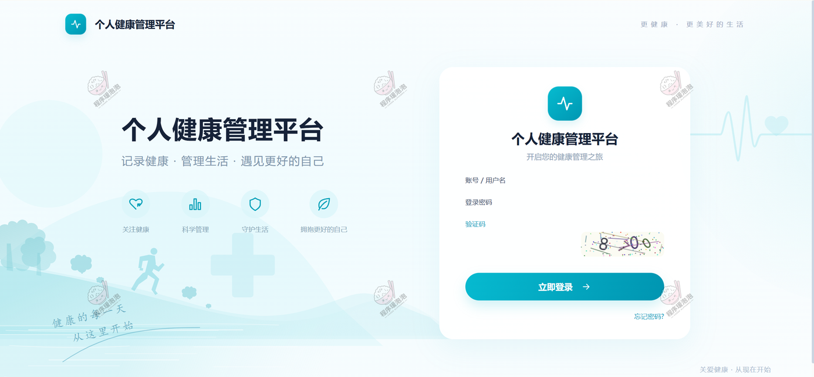

### 一、用户端（微信小程序）

底部五个 tab：首页、体检识别、数据分析、AI问答、我的。

**首页与今日概览**
顶部是今日步数进度条，旁边两张卡片放最新体重和血糖；快捷入口通向健康记录、生活记录、健康提醒、健康目标、设备管理。往下的「今日目标」是三项进度，「今日提醒」按时间列出当天要做的喝水提醒，「近期记录」把体重、睡眠、运动、血压混排成时间线——体重 74.3 kg / BMI 25.7、睡眠 7.0 小时、运动 25 分钟消耗 120 千卡、血压 114/72 mmHg 心率 66 次/分。

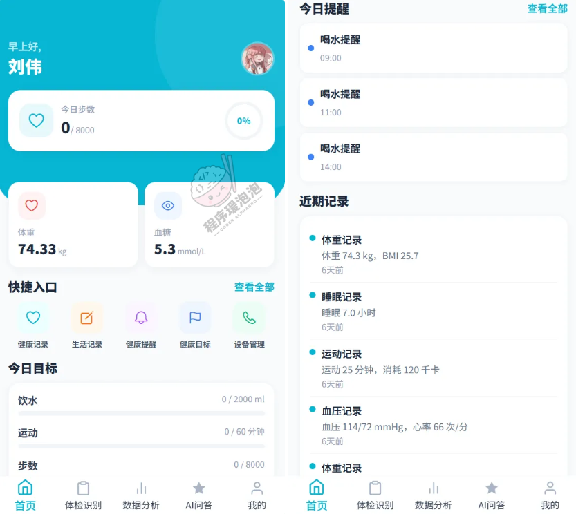

**健康记录与健康提醒**
左图是健康记录，按体重、血压、血糖、血脂、睡眠切 tab，每条记录带日期、数值和 BMI 这类派生结果，可编辑可删除，右下角加号新增。右图是健康提醒，三类提醒各自带开关，重复规则和推送时刻写在卡片上，底部能跳去看提醒记录。

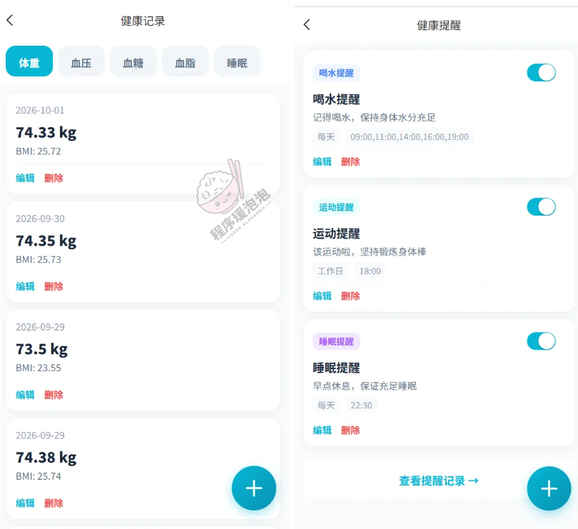

**体检报告与指标录入**
左图两个入口：手动录入、体检单识别。历史记录里已分析的报告会附一段分析摘要。右图是编辑页，体检日期、最多 3 张体检单图片、指标清单（本例 8 项）都能改；每项显示数值、单位、正常范围和判定标签，如空腹血糖 5.2 mmol/L（正常范围 3.9~6.1）、总胆固醇 4.8 mmol/L（3.1~5.7），也能手动添加指标。

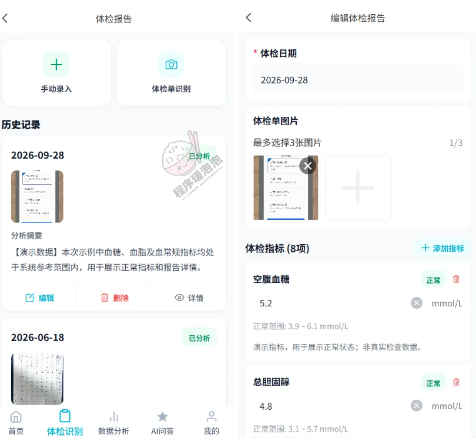

**数据分析**
按周切换（上周 9.28–10.4），六个指标 tab。左图体重页：平均值 74.4、最高值 74.4、最低值 74.3、记录数 5，下面是有记录 4 天 / 无记录 3 天的活跃度环和体重日趋势柱图。右图切到睡眠页，同样四张小卡换成 7.8 / 9 / 7 / 5，柱状图按周一到周日列出每天的睡眠小时数。

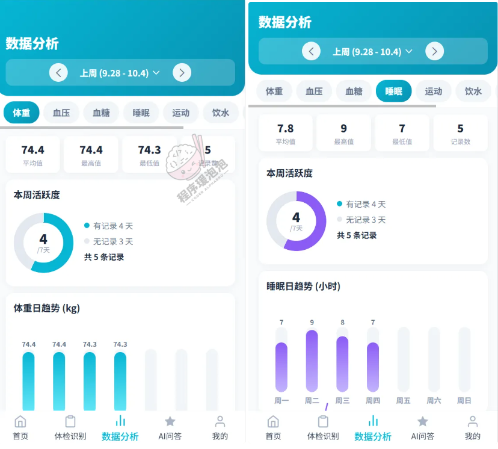

**AI 健康问答**
对话页用「健康小助手」开场，三个预设问题点一下就能发，底部自由输入。切到历史会话是按日期排的提问列表，规律作息记录、如何科学减肥、血压偏高怎么办这类问题都能回看或单条删除。

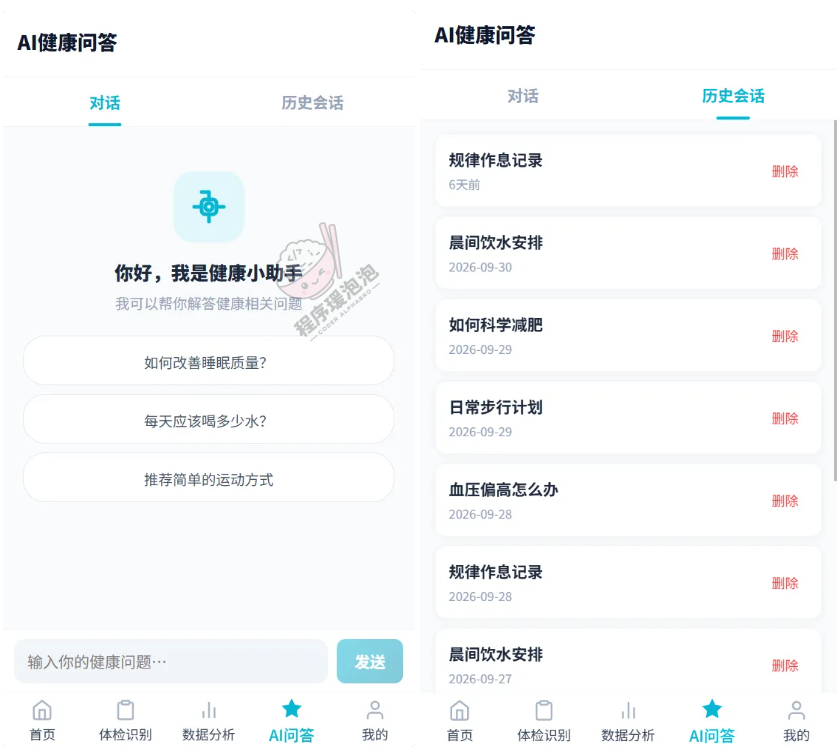

**个人中心与健康周报**
左图是「我的」：编辑资料、我的周报、周报大厅、健康目标、提醒设置、微信绑定、修改密码。右图是周报列表，2026 年第 40 周给了 62 分，活跃天数 4 天、记录条数 39 条、运动时长 190 min，摘要里写清体重均值 74.2 kg（↓0.3 kg）、血压 116/74 mmHg、血糖 5.4 mmol/L、睡眠 7.9 h 这些变化；每条周报带私密标记和「公开分享」按钮，下面还能翻到更早一周的记录。

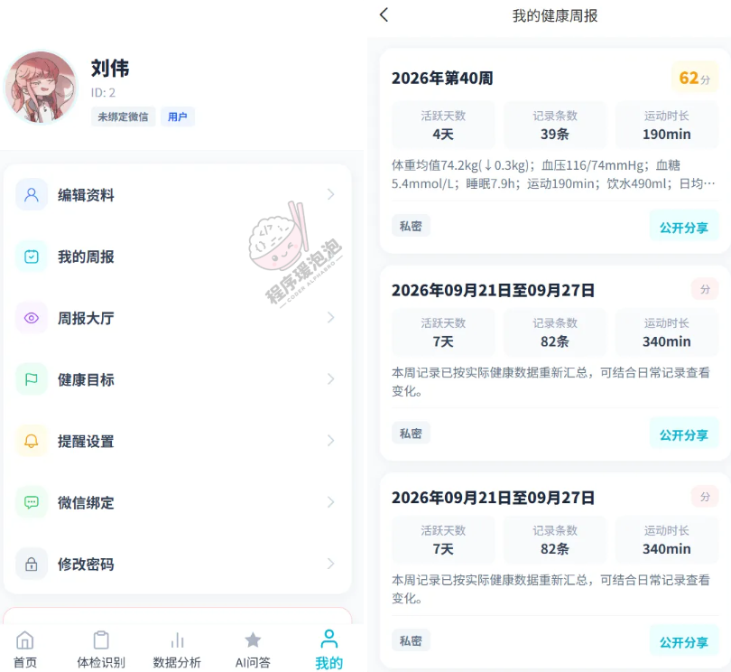

### 二、管理员端（Web 后台）

左侧菜单分五组：导航菜单（系统管理、账号管理）、健康数据、生活记录、目标与提醒、体检 OCR 数据、健康周报、数据统计。各类记录列表共用一套查询骨架——按用户、日期区间、关键词筛选，支持批量删除和导出，下面挑几张有代表性的放出来。

**体重记录**
健康数据这一组的样子：用户、记录日期、体重、BMI 指数、备注，BMI 由身高体重算好直接列在表里，不用自己再算。同组的血压、血糖、血脂记录版式一致，列名换成收缩压 / 舒张压 / 心率、空腹血糖、总胆固醇 / 甘油三酯 / 高密度脂蛋白 / 低密度脂蛋白；小程序首页那条血压 114/72、心率 66 在后台血压表里也能查到。

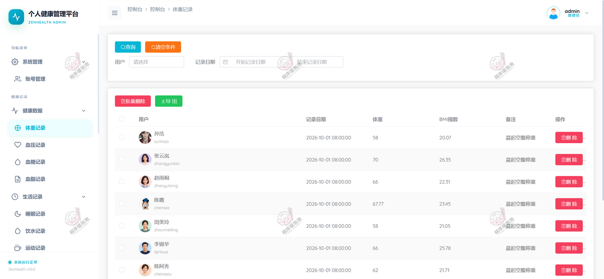

**饮食摄入记录**
生活记录这一组的代表：按关键词、用户、餐次类型、记录日期查，表格列餐次、食物名称、数量、单位和摄入卡路里。同组还有睡眠、饮水、运动、心情记录，运动记类型和步数，心情记评分、标签和描述。

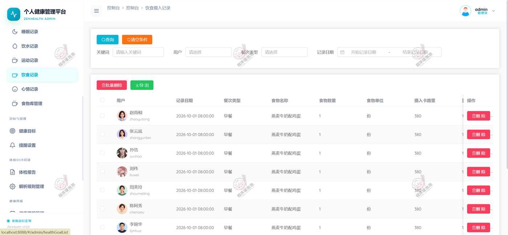

**食物库管理**
饮食记录里卡路里的出处。按食物名称和分类检索，逐条维护卡路里、蛋白质、脂肪、碳水、单位和描述（如面条 137 kcal / 4.5 g 蛋白 / 28.4 g 碳水），可新增、修改、批量删除。

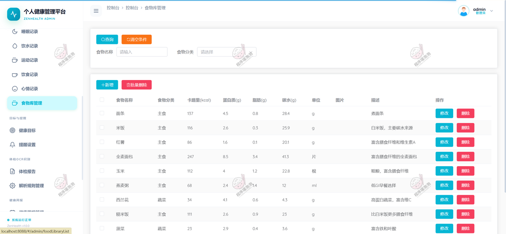

**健康目标**
按用户列六项目标：每日饮水、每日睡眠、每日卡路里摄入、每日运动、目标体重、每日步数。刘伟这行是 2000 / 8 / 2000 / 60 / 70 / 8000，正好对应小程序首页「饮水 0/2000 ml、运动 0/60 分钟、步数 0/8000」的三条进度条——前台的完成度就是拿这张表当分母算的。

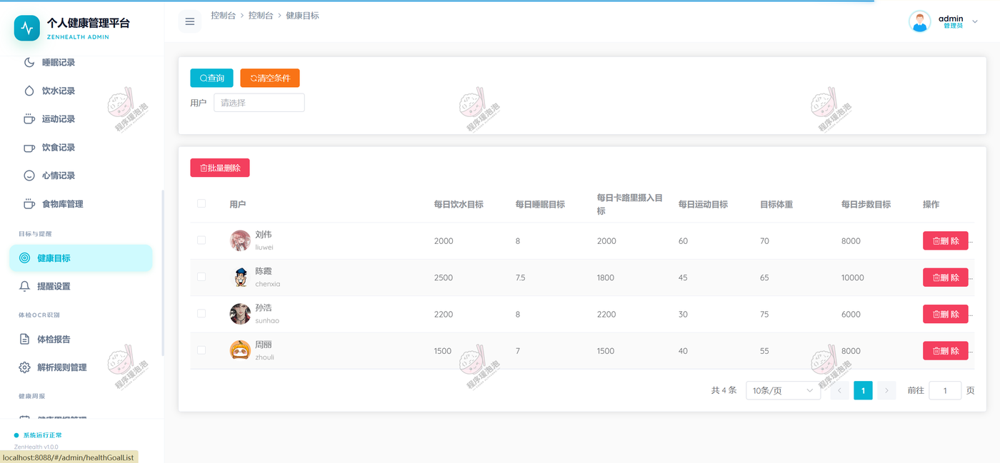

**提醒设置**
筛选条件比别处多一层：关键词、用户、提醒类型、重复模式、提醒时间区间、是否启用。列表把提醒标题、内容、类型、重复模式、提醒时间、启用状态摊开，刘伟的喝水 / 运动 / 睡眠三条与小程序端一一对应，其他用户还有测量血压、服药提醒这类自定义项。

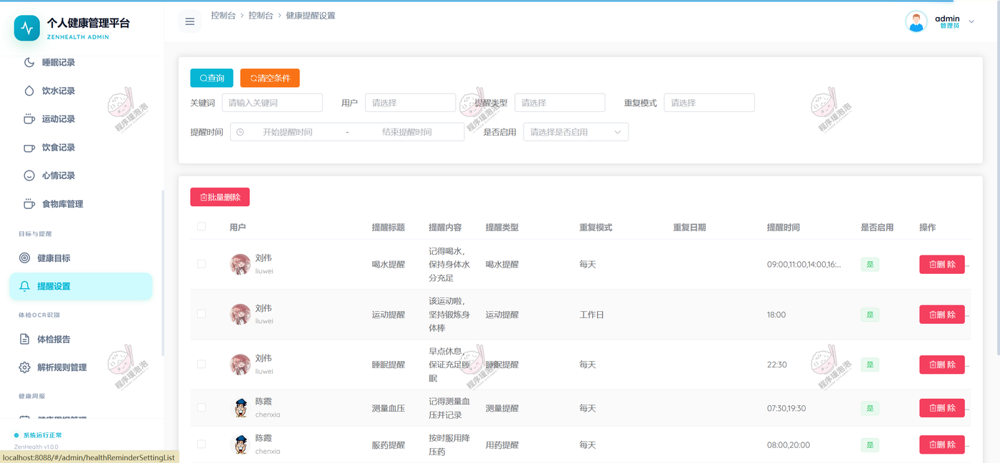

**体检报告管理**
按用户、分析状态、体检日期查，每条带体检单缩略图。列表里能看到「待分析」和「已分析」两种状态，已分析的会填进分析结果和饮食建议——比如尿酸、总胆固醇、低密度脂蛋白偏高就建议减少海鲜、动物内脏、油炸食品；白细胞明显升高则建议均衡饮食、保证充足睡眠。

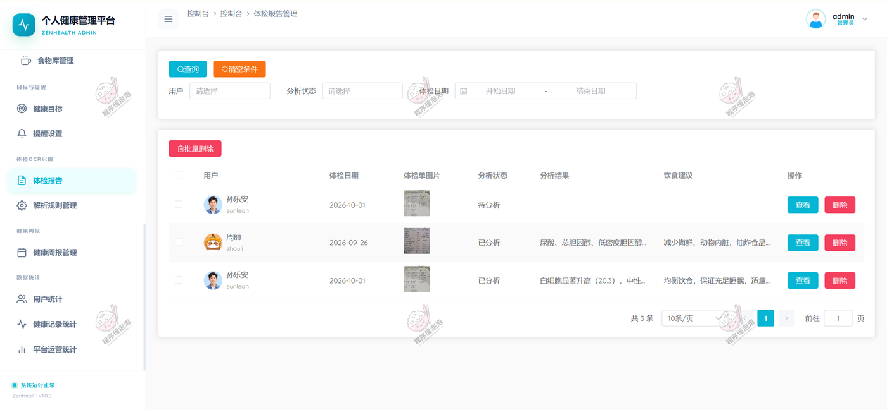

**解析规则管理**
整套体检单解析的判定依据。指标名称、正常值下限、正常值上限、单位、解读模板、饮食建议六列，血红蛋白 120~160 g/L、收缩压 90~140 mmHg、空腹血糖 3.9~6.1 mmol/L、总胆固醇 3.1~5.7 mmol/L 都在这里。小程序报告页显示的「正常范围」正是引用这两列，解读模板和饮食建议则用于生成后台的分析结果。

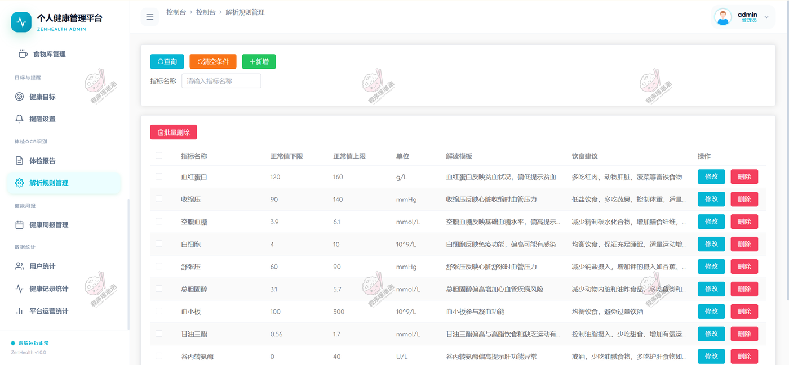

**健康周报管理**
按用户、是否公开、周开始日期查询，右上角留了「手动生成周报」按钮。列表列周标签（2026 年第 40 周）、健康评分、平均体重、平均睡眠、运动时长、活跃天数、是否公开和摘要，摘要里会带上体重环比变化，和小程序「我的周报」看到的是同一批数据。

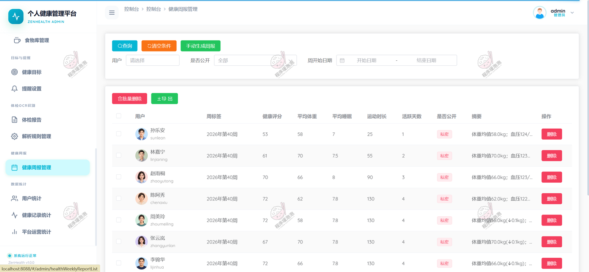

**健康记录统计**
平台侧的数据看板：总记录数 1268、今日记录 0、本周记录 0、本月记录 89；下方是近 30 天每日记录趋势面积图，右侧环形图按记录类型拆分占比，血糖 154 条、血压 160 条、血脂 22 条、体重 155 条等逐项列出。同组还有用户统计和平台运营统计两个页面。

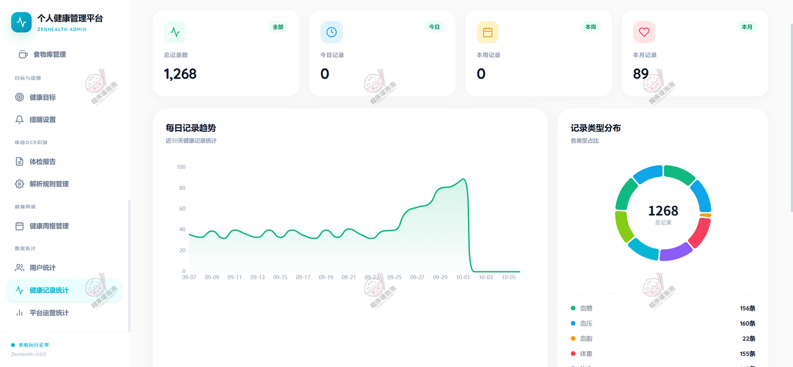

### 其余模块

后台菜单里还有几处与上面版式接近、没有重复贴图的页面：

- 健康数据：血压记录、血糖记录、血脂记录
- 生活记录：睡眠记录、饮水记录、运动记录、心情记录
- 数据统计：用户统计、平台运营统计
- 导航菜单：系统管理、账号管理
- 小程序端：健康目标进度、生活记录填写、提醒记录、周报大厅、设备管理

## 说明

- 文档展示 16 张截图，需要了解更多，请联系我。
- 截图中的姓名、体检指标、记录数值为演示数据；体检单识别与 AI 问答走 DeepSeek API，报告页也有标注「演示指标，用于展示正常状态」的样例。
- 后台按 B/S 架构部署，Spring Boot 3 + MySQL 提供接口，Vue 3 打包后由 Nginx 托管，小程序端用 HBuilderX 编译发布。

